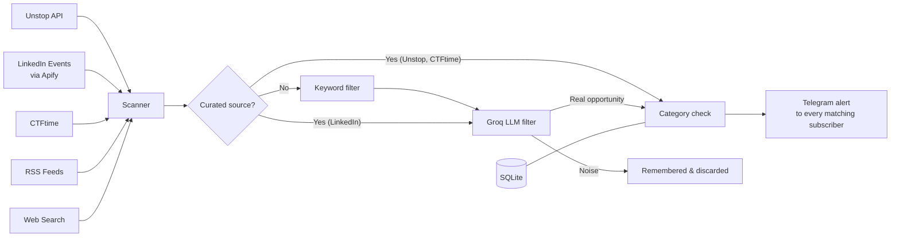

# snipe 🎯

[](https://github.com/Dreadonyx/snipe/actions/workflows/ci.yml)

> Telegram bot that hunts down hackathons, internships, fellowships, CTFs, competitions, and LinkedIn events — and texts you before the rest of the internet finds out.

Most opportunity aggregators are noisy or slow. Snipe runs every 30 minutes, filters results through an LLM, and only pings you when something is actually worth your time. **You choose what categories you care about.**

## Architecture



## How it works

1. Scans **Unstop, LinkedIn events, CTFtime, RSS feeds, and web search** every 30 minutes — all sources in parallel
2. **Structured sources** (Unstop, CTFtime) come with real deadlines, prize pools, stipends, and locations — no LLM guessing
3. **Groq LLM** filters everything else — only real, actionable opportunities pass; noise is remembered so it's never re-checked
4. Checks each subscriber's **category preferences** and broadcasts to everyone who wants it
5. **SQLite** deduplication (with URL normalization) ensures you never see the same thing twice

Resilience built in: failing sources back off and retry automatically, transient LLM errors are retried next scan, a per-scan alert cap prevents floods, and users who block the bot are unsubscribed.

## Example alert

```
📅 EVENT

GenAI Buildathon
A one-day hands-on workshop for students to build an LLM app with mentors from Google.

🏢 By: GDG Chennai
📆 When: Sat, 24 Oct 2026, 10:00 AM
📍 Where: Chennai, India (In person)
📡 Source: LinkedIn
🔗 Register here
```

## Commands

| Command | Description |
|---|---|
| `/start` | Subscribe to alerts |
| `/stop` | Unsubscribe |
| `/status` | Check your status and active filters |
| `/filter` | Choose which categories you want (inline keyboard) |
| `/settings` | Delivery mode, quiet hours, location, paid-only, deadline filter (buttons) |
| `/interests ai, web dev` | Only get alerts about these topics (`/interests clear` to reset) |
| `/mute mba, sales` | Never get alerts about these topics |
| `/city Chennai` | Show online events plus in-person ones in your city |
| `/stipend 10000` | Hide internships paying less than this per month |
| `/quiet 23 7` | Custom quiet hours (`/quiet off` to disable) |
| `/scan` | Trigger a manual scan right now |
| `/stats` | View scan statistics |
| `/help` | Show all commands |

## Categories

| Emoji | Category |
|---|---|
| 🏆 | Hackathon |
| 💼 | Internship |
| 🎓 | Fellowship |
| 🏅 | Competition |
| 💰 | Grant / Scholarship |
| 🐛 | Bug Bounty |
| 🚩 | CTF |
| 📅 | Event / Workshop |

Use `/filter` to toggle categories on/off. All are enabled by default.

## Make it yours (and no spam)

Every subscriber tunes Snipe for themselves — nothing here affects anyone else:

- **Instant or daily digest** — get alerts as they drop, or one summary a day at 06:00 / 08:00 / 12:00 / 18:00 / 21:00
- **Quiet hours** — on by default (23:00–07:00); anything found overnight arrives as one message in the morning
- **Batching** — when more than 3 alerts land at once, they come as one combined message instead of a flood
- **Interests & mutes** — whole-word topic matching (`ai` matches "AI hackathon", not "email")
- **Location** — anywhere, online only, or online + your city
- **Internship pay** — paid only, or a minimum monthly stipend
- **Deadline filter** — hide anything closing within 2, 5, or 7 days

Filters only drop an alert when they *know* it doesn't fit — an item with no location info still reaches an "online only" user rather than vanishing. Location, stipend, and deadline data come from Unstop and LinkedIn; RSS and web results rarely include them.

## LinkedIn events

LinkedIn puts event pages behind a login wall and blocks search engines from indexing their details, so Snipe gets them through the [LinkedIn Events Scraper](https://apify.com/maximedupre/linkedin-events) on Apify, which reads public event data without a LinkedIn account. Your own LinkedIn account is never used.

- **With `APIFY_TOKEN`** — full details: title, date/time, organizer, location, format. Events go through the LLM filter, so sales webinars and the like get dropped.
- **Without it** — Snipe still finds LinkedIn event links via web search, but they arrive without details.

**Cost:** Apify bills about $2.70 per 1,000 events. Snipe runs LinkedIn every 12 hours (not every scan) with a hard spending cap of $0.05 per run, so the default settings stay under ~$3/month — inside Apify's free monthly credit. Tune `interval_hours`, `max_charge_usd`, `queries`, and `locations` under `sources.linkedin` in `config.yaml`.

## Setup

```bash
git clone https://github.com/Dreadonyx/snipe
cd snipe
python -m venv .venv && source .venv/bin/activate
pip install -r requirements.txt

# Set up your secrets
cp .env.example .env
# Edit .env with your Telegram bot token + Groq API key (+ optional Apify token)

# Optionally customize sources/keywords
cp config.example.yaml config.yaml

# Run
python -m snipe
```

You'll need:
- A Telegram bot token (from [@BotFather](https://t.me/BotFather))
- A free [Groq API key](https://console.groq.com)
- *Optional:* an [Apify API token](https://console.apify.com/settings/integrations) for LinkedIn event details

### Environment variables

| Variable | Required | Description |
|---|---|---|
| `TELEGRAM_TOKEN` | ✅ | Bot token from BotFather |
| `GROQ_API_KEY` | ✅ | Groq API key |
| `APIFY_TOKEN` | | Enables full LinkedIn event details |
| `SNIPE_DB_PATH` | | SQLite file location (default `./snipe.db`) |
| `SCAN_INTERVAL` | | Minutes between scans (overrides `config.yaml`) |
| `TZ_NAME` | | Timezone for quiet hours and digests (default `Asia/Kolkata`) |

## Development

```bash
pip install -r requirements-dev.txt
pytest          # offline — all HTTP, Groq, and Telegram calls are mocked
ruff check .
```

CI runs both on every push and pull request.

## Project Structure

```
snipe/
├── snipe/
│   ├── __init__.py       # Package init
│   ├── __main__.py       # Entry point (python -m snipe)
│   ├── bot.py            # Telegram handlers, broadcast & scheduler
│   ├── config.py         # Config loading & validation
│   ├── database.py       # SQLite (subscribers, prefs, logs) + migrations
│   ├── formatter.py      # LLM-powered classification & alert formatting
│   ├── preferences.py    # Per-user settings, filters, quiet hours
│   ├── scanner.py        # Unstop, LinkedIn, CTFtime, RSS, web search
│   └── urls.py           # URL normalization for deduplication
├── tests/                # pytest suite
├── .github/workflows/    # CI
├── .env.example          # Secrets template
├── config.example.yaml   # Sources & keywords config
├── Dockerfile
├── requirements.txt
├── requirements-dev.txt
├── Procfile              # Railway/Heroku deployment
└── README.md
```

## Deployment

### Railway

1. Push to GitHub
2. Connect repo on [Railway](https://railway.app)
3. Set environment variables: `TELEGRAM_TOKEN`, `GROQ_API_KEY` (and `APIFY_TOKEN` for LinkedIn)
4. **Add a volume** mounted at `/data` and set `SNIPE_DB_PATH=/data/snipe.db` — otherwise every redeploy wipes your subscribers and re-sends old alerts
5. Railway auto-detects the `Procfile` and runs `python -m snipe`

### Any Linux VM (Oracle Cloud, Google Cloud, a home server)

```bash
git clone https://github.com/Dreadonyx/snipe && cd snipe
cp .env.example .env && nano .env      # add your tokens
bash deploy/install.sh                 # installs Docker, builds, runs with auto-restart
```

Re-run `deploy/install.sh` after `git pull` to update. A `snipe.db` in the folder is copied in on first install, so existing subscribers carry over. Only run **one** copy of the bot per token — two copies fight over Telegram updates.

### Docker

```bash
docker build -t snipe .
docker run -d --env-file .env -v snipe-data:/data snipe
# Custom config: add  -v ./config.yaml:/app/config.yaml:ro
```

## Stack

- **Python** + python-telegram-bot (with built-in rate limiting)
- **Groq API** (gpt-oss-20b) — opportunity classification
- **Unstop API** — hackathons, competitions, internships, scholarships
- **Apify** — LinkedIn event details
- **CTFtime** — CTF event feed
- **DuckDuckGo (ddgs)** — live web search
- **SQLite** — persistence
- **APScheduler** — automated scanning
